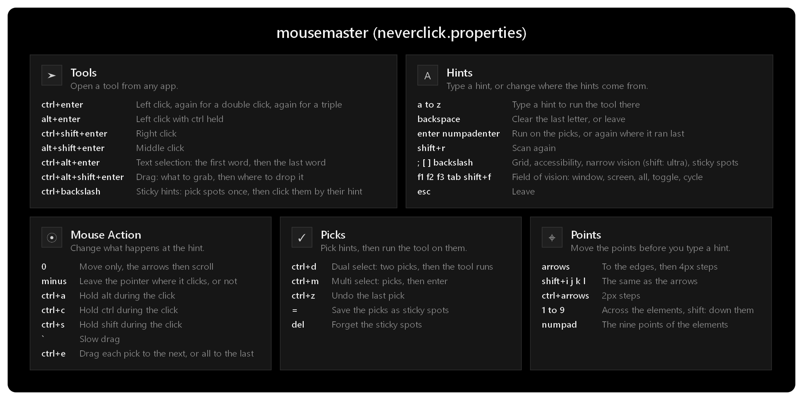

# Neverclick configuration for mousemaster ([neverclick.properties](../configuration/neverclick.properties))

[Neverclick](https://www.neverclick.com), the mousemaster way.

https://github.com/user-attachments/assets/4725e4a2-9223-4aaa-be56-05647eadde0e

## Tools

From any app:

| Keys                   | Tool                                                    |
|------------------------|---------------------------------------------------------|
| `Ctrl+Enter`           | Left click (again in the hints: double, then triple)    |
| `Alt+Enter`            | Ctrl+click                                              |
| `Ctrl+Shift+Enter`     | Right click                                             |
| `Alt+Shift+Enter`      | Middle click                                            |
| `Ctrl+Alt+Enter`       | Text selection: the first word, then the last           |
| `Ctrl+Alt+Shift+Enter` | Drag: what to grab, then where to drop it               |
| `Ctrl+\`               | Sticky hints                                            |

The hints mark what computer vision finds on every screen. The first hint keys (`j f k d l s a …`) make the shortest labels, near the center of the screen. A tool hotkey pressed in the hints changes the tool without a new scan.

While the hints are open, every key but Print Screen goes to mousemaster. A toast at the bottom left names each change.

Hold `?` while the hints are open to show this cheatsheet.

## In the hints

- `Backspace` clears the last letter, or leaves. `Esc` leaves.
- `Enter` runs the tool on the picks, or again where it last ran.
- `Shift+R` scans again.
- Hint source: `;` a grid, `[` the accessibility elements of the active window, `]` denser vision hints (`Shift+]` the densest), `\` the sticky spots. The same key again goes back to the vision hints, or for the grid, to the hints under it.
- Field of vision: `F1` the active window, `F2` its screen, `F3` every screen, `Tab` window or all, `Shift+F` the next one. It is kept for the next activations.

## Mouse action

- `0` moves the pointer without a click. The arrows then scroll, and any other key leaves.
- `-` leaves the pointer where the tool clicked (kept for the next activations).
- `Ctrl+A`, `Ctrl+C`, `Ctrl+S` (or `,` `.` `/`) hold Alt, Ctrl, Shift during the click.
- In a drag, `` ` `` makes it slow, and `Ctrl+E` drags each pick to the next one instead of all to the last (kept for the next activations).

## Picks

- `Ctrl+D` (or `'`): dual select. Two picks, then the tool runs.
- `Ctrl+M` (or `Shift+'`): multi select. Any number of picks, then `Enter` runs the tool on each one in order. A drag drags them to the last pick.
- `Ctrl+Z` undoes the last pick.

A pick stays on screen, outlined, with a dashed line to the next one.

## Refine

`Ctrl+T`, then a hint: the tool waits, with a dot on its target. Move the target, then `Enter` runs the tool there, or picks it in a dual or multi select. `Backspace` cancels. `Ctrl+T` again turns refine off.

- Arrows (or `Shift+I J K L`): the first one to the element's edge, then 4px steps. Hold `Ctrl` for 2px steps.
- `1` to `9`: across the element in eighths, from the left edge (`1`) through the center (`5`) to the right edge (`9`). `Shift` and a digit: down it.
- Numpad: the nine points of the element.

The mouse action and pick keys work in a refine too.

## Sticky hints

- `=` in the hints: the hints typed next become sticky spots (26 at most). `Enter` or `=` shows them.
- `Ctrl+\` shows the sticky spots, or starts to pick them when there are none. Type the hint of a spot to click it: the sticky hints stay open for the next click.
- In the sticky hints, `=` goes back to the hints to add more, and `Delete` forgets them all.

## Rebinding

Every key is an alias at the top of [neverclick.properties](../configuration/neverclick.properties), e.g. `key-alias.toolkey.us-qwerty=enter numpadenter`: change the value to remap. `hintkey` lists the hint keys in priority order.
